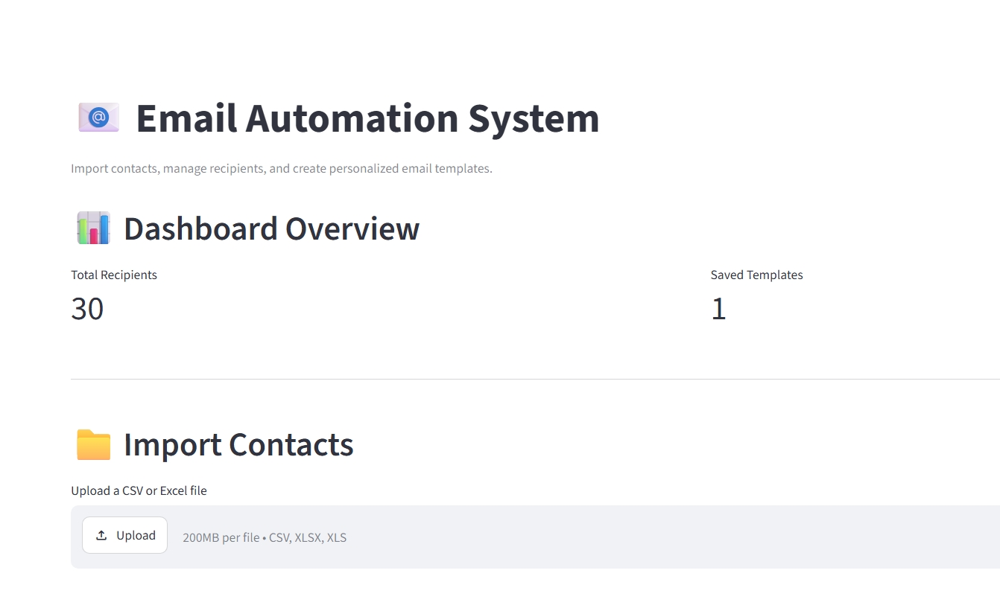
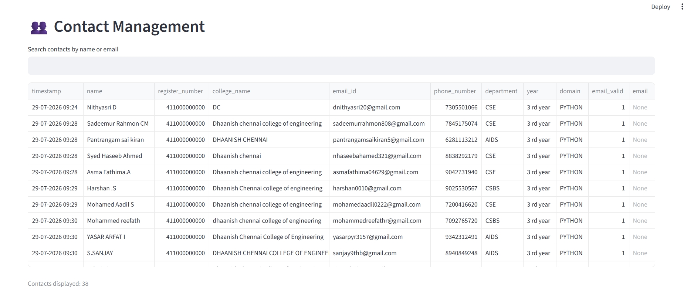
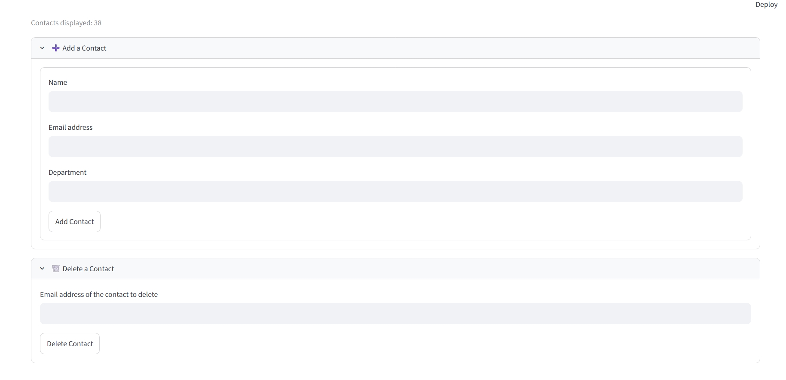
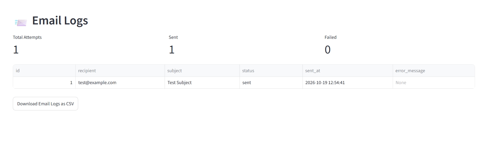

# 📧 Email Automation System

A Python-based Email Automation System for importing contact data, validating email addresses, managing contacts with SQLite, and supporting personalized email workflows through a Streamlit dashboard.

## 📌 Project Overview

The Email Automation System simplifies contact management by combining CSV and Excel data import, email validation, database storage, personalized email templates, and email activity logs.

The project uses reusable Python modules and automated tests to support maintainability and reliable data processing.

## ✨ Features

- **CSV Import:** Import contact data from CSV files.
- **Excel Import:** Import contact data from Excel files.
- **Data Cleaning:** Normalize column names and remove surrounding whitespace.
- **Email Validation:** Validate email address formats.
- **SQLite Database:** Store and retrieve contact records.
- **Contact Management:** Add, view, search, and delete contacts through the dashboard.
- **Email Templates:** Prepare personalized email subjects and message bodies.
- **Streamlit Dashboard:** Interact with supported features through a visual interface.
- **Email Logs:** View recorded email attempts, statuses, and error messages.
- **Automated Testing:** Test project functionality using Pytest.
- **Code Quality:** Use Black and Ruff to maintain consistent Python code.

> Features such as actual email delivery should be considered complete only after they have been implemented and tested successfully.

## 🛠️ Technology Stack

- Python
- Pandas
- SQLite
- OpenPyXL
- Streamlit
- SMTP, if configured for email delivery
- Pytest
- Black
- Ruff
- Git and GitHub

## 📂 Project Structure

```text
email-automation-system/
├── dashboard/
│   └── streamlit_app.py
├── modules/
│   ├── importer.py
│   ├── validator.py
│   ├── database.py
│   ├── template_engine.py
│   └── email_sender.py
├── tests/
├── data/
├── app.py
├── requirements.txt
├── .env.example
├── .gitignore
└── README.md
```

*Note: This is an illustrative structure. Your repository may contain additional modules and files.*

## 🚀 Installation and Setup

### 1. Clone the Repository

```bash
git clone https://github.com/hariniraj453/email-automation-system.git
cd email-automation-system
```

### 2. Create a Virtual Environment

For Windows PowerShell:

```powershell
python -m venv venv
.\venv\Scripts\Activate.ps1
```

### 3. Install Dependencies

```bash
python -m pip install -r requirements.txt
```

### 4. Prepare Contact Data

Prepare a CSV or Excel file with the columns required by your application, such as:

- Name
- Email
- Department

Use synthetic sample data when testing or demonstrating the application.

## ▶️ Running the Application

### Launch the Streamlit Dashboard

Run this command from the project root:

```bash
python -m streamlit run dashboard/streamlit_app.py
```

Open the local URL displayed in your terminal.

### Run the Command-Line Application

If `app.py` is configured as a working entry point, run:

```bash
python app.py
```

## 📸 Application Screenshots

### 1. Dashboard Overview

The dashboard displays recipient statistics and provides the contact import interface.



### 2. Contact Management

View and search contact records managed by the application.



### 3. Add and Delete Contacts

Add new contacts or delete existing records through the dashboard.



### 4. Email Logs

Review recorded email attempts, sending statuses, and error messages.



## 🧪 Testing

Run the automated tests:

```bash
python -m pytest -v
```

Check Python formatting:

```bash
python -m black --check .
```

Check code quality:

```bash
python -m ruff check .
```

## 🔐 Privacy and Security

- Use synthetic contact data for development and demonstrations.
- Store credentials in environment variables.
- Keep `.env` files, passwords, API keys, and private contact data out of GitHub.
- Do not commit real contact databases or unnecessary generated files.
- Use authorized SMTP accounts when testing email delivery.

## 🔮 Future Improvements

- Automated testing through GitHub Actions.
- Improved email template customization.
- Scheduled email workflows.
- Enhanced dashboard reporting and analytics.
- Additional validation and error-handling tests.

## 👩‍💻 Author

**Harini R.**

- GitHub: [hariniraj453](https://github.com/hariniraj453)
- LinkedIn: [Harini R.](https://linkedin.com/in/harini-r-492ba0328)

## 📄 License

A license can be added if you intend to specify how others may use, modify, and distribute this project.